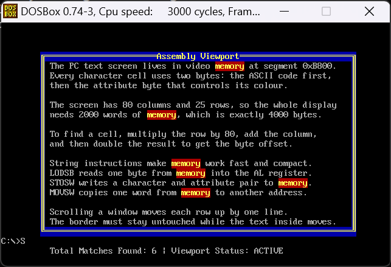
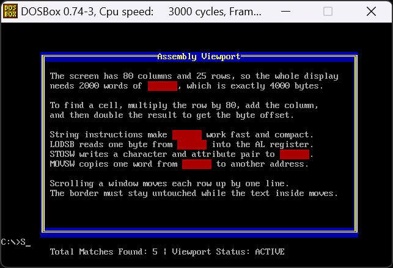

# COAL_Semester-3 - Assembly Language Programs

**Name:** Ali Haziq  
**Roll No.:** 25L-0686  
**Repository:** https://github.com/mAliHaziq/COAL_Semester-3

This repository contains my Computer Organization & Assembly Language (COAL) programs, written in 16-bit 8088 assembly for DOS. Each assignment is in its own folder (this assignment is in `A3/`).

---

## Q2: Text Viewport Manager with Windowed Scrolling & Live Keyword Highlighter

### Description

A text-mode document viewer that writes directly into video memory (segment `0xB800`). The program:

1. Clears the 80x25 screen using `REP STOSW`.
2. Draws a double-line bordered window (rows 3 to 21, columns 8 to 72) with a centred title banner (attribute `0x1E`, yellow on blue).
3. Streams a multi-line document into the window using `LODSB` / `STOSW`. Text stays inside rows 4 to 20 and columns 10 to 70. Lines longer than the window are truncated, so they never damage the margin or the border.
4. Scrolls only the text inside the window upwards by N lines (`scroll_window_up`) using `MOVSW` row by row with a 160-byte row stride, then blanks the vacated bottom lines with `STOSW`. The borders and the rest of the screen are untouched.
5. Searches the visible text for a keyword (`find_and_highlight`) using `LODSB` + `SCASB`, and changes only the attribute byte of every match (`0xCE`, blinking yellow on red). The ASCII characters are never modified.
6. Shows a status bar on row 23: `Total Matches Found: [Count] | Viewport Status: ACTIVE`, where the count is printed by a stack-based `printNum` routine.

### Subroutines

| Subroutine | Purpose |
|---|---|
| `clrscr` | Clears the whole screen |
| `draw_outer_viewport` | Draws the double-line border |
| `draw_title_banner` | Draws the centred title |
| `text_stream` | Streams the document into the window with boundary checks |
| `scroll_window_up` | Scrolls only the window interior up by N lines |
| `find_and_highlight` | Finds the keyword on screen, highlights it, returns the match count in `AX` |
| `printNum` | Prints a number using the stack (divide by 10, push remainders, pop to print) |
| `print_string` | Prints a null-terminated string at a given row and column |

All procedures receive their parameters through the stack, access them with `[bp + offset]`, use local variables (`sub sp, N` / `[bp - offset]`), preserve the registers they modify, and clean up with `ret n`.

### Notes on the document text

- Each line of the document is a null-terminated string, and the whole document ends with an extra `0` (two zero bytes in a row).
- A blank line must be written as `db ' ', 0` (a single space), not `db 0`, otherwise it would be read as the end of the document.
- The keyword search is case-sensitive, and the search only counts what is currently visible on screen. So the match count changes after scrolling.

---

## Tools Used

- **NASM** (assembler)
- **DOSBox** (DOS emulator to run the `.com` program)
- **AFD** (debugger, used to step through the code)
- **Notepad++** (editor, with NppExec scripts for assembling, running and debugging)

All of these come from the Assembly Programming Package:
https://github.com/ASD0x41/Assembly-Programming-Package

---

## How to Assemble and Run

The program is written for NASM as a `.com` file (`[org 0x0100]`) and is built and run through the Assembly Programming Package.

1. Download the package from the link above, extract it, and open the shortcut named `code`.
2. Open `A3/Code/a3q2.asm` in Notepad++.
3. Press **Alt + D** to assemble the program and debug it in AFD (step through the instructions, and watch registers and the stack).
4. Press **Alt + R** to assemble and run the program in DOSBox and see the final output on screen.

To change the number of lines scrolled, edit the value pushed just before `call scroll_window_up` in `start`, and run again. To change the search word, edit the `keyword` string in the data section.

---

## Folder Structure

```
COAL_Semester-3/
|-- A3/
|   |-- README.md
|   |-- COAL_Assignment3_Fall2026.pdf
|   |-- Code/
|   |   |-- a3q2.asm
|   |-- screenshots/
|   |   |-- 01_window_and_title.png
|   |   |-- 02_text_no_scroll_highlighted.png
|   |   |-- 03_text_scrolled_highlighted.png
|   |   |-- 04_status_bar.png
```

---

## Output Screenshots

### 1. Window frame and title banner


### 2. Document with keyword highlighted (no scrolling, N = 0)


### 3. After `scroll_window_up` (N = 3): borders intact, blank lines at the bottom, new match count


### 4. Status bar on row 23
